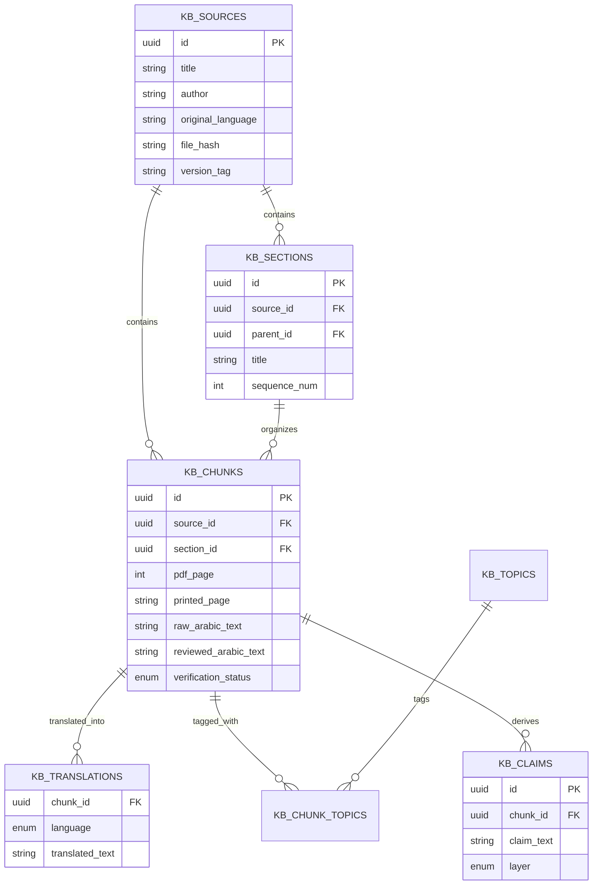

# Ṭibb al-Nabī Knowledge Base Architecture (Phase 4.4)

> **Architectural Note (Phase 4.6)**: The *Ṭibb al-Nabī* knowledge-base infrastructure (`kb_sources`, `kb_sections`, `kb_chunks`, 174 sections, 3,773 chunks) is fully retained and preserved in the database and repository history. However, as of Phase 4.6, the primary specialized theme of MyAI is **Safety & Security Analysis** (`safety-checkup`). Active feature development focuses on digital safety, threat verification, and risk assessment.

## 1. Purpose
This document outlines the architecture for the knowledge base that originally powered the *Ṭibb al-Nabī* (Prophetic Medicine) theme. Phase 4.4 was exclusively a design phase. The objective was to design a strict, future-proof schema that securely handles Arabic source material, distinguishes between exact text and interpretations, safely layers evidence, and seamlessly integrates with the existing deterministic Theme Engine (Phase 4.3).

## 2. Current Available Source Material
The sole authoritative knowledge material at this stage is:
*   **File:** `tebalnabawy.pdf`
*   **Title:** *الطب النبوي* (Al-Tibb al-Nabawi)
*   **Author:** Ibn Qayyim al-Jawziyya
*   **Format:** PDF and its extracted Markdown/text counterpart.
*(Note: External websites, wikis, modern medical blogs, or additional books are explicitly excluded in this phase).*

## 3. Architecture Diagram

## 4. Proposed Tables and Field Definitions
*(See `knowledge-base-schema.sql` for the complete unexecuted schema proposal)*

1.  **`kb_sources`**: Represents the physical book artifact (PDF). Contains nullable metadata (edition, publisher, year) to ensure we don't invent unverifiable data. Uses `file_hash` to prevent duplicate ingestion and `version_tag` to trace extraction versions.
2.  **`kb_sections`**: Allows hierarchical nesting (e.g., Book -> Chapter -> Section) via a `parent_id`.
3.  **`kb_chunks`**: The core retrieval unit. Maps exactly to a `pdf_page` and `printed_page`.
4.  **`kb_translations`**: Separates translated text (English/Malayalam) from the Arabic source, ensuring 1:1 parity and easy extendability without altering the core schema.
5.  **`kb_topics` & `kb_chunk_topics`**: An associative taxonomy. Topics are extracted and linked, not hardcoded.
6.  **`kb_claims`**: Represents structured factual claims linked directly to evidence layers (e.g., "Honey cures X" explicitly tagged as `classical_scholarly` vs `modern_scientific`).

## 5. RLS Strategy
The Knowledge Base acts as a strict "Read-Only" authoritative source for end-users.
*   **Public/Authenticated Reads**: `SELECT` policies are open to all `authenticated` users so the app can retrieve citations and display source text.
*   **Admin/Service Writes**: `INSERT/UPDATE/DELETE` operations have NO policies for normal users. They are strictly handled by Supabase's `service_role` (the backend ingestion and review pipeline).
*   This prevents users from tampering with historical texts or altering medical disclaimers.

## 6. Source Provenance & Arabic Preservation
**The Golden Rule:** The system must never silently correct or modify the author's original text.
*   `kb_chunks.raw_arabic_text`: The immutable output directly from the PDF OCR/Extraction.
*   `kb_chunks.reviewed_arabic_text`: A nullable field. If an OCR error is found, the human-verified correction is stored here. The UI/LLM will prefer `reviewed_arabic_text` if it exists, but the `raw_arabic_text` provenance is never lost.
*   Extracted Markdown is treated as a *derived representation* mapped to `kb_chunks`, not a new authoritative source.

## 7. PDF / Page / Chunk Model
Citations require absolute accuracy.
*   `kb_chunks` tracks both `pdf_page` (the exact digital page number for linking/rendering) and `printed_page` (the string printed on the page, e.g., "14" or "XIV" for classical citations).
*   Chunks belong to `kb_sections` and follow a strict `sequence_num` to reassemble logical reading order even if physical pages break sentences.

## 8. Claim and Evidence Layers
To prevent dangerous conflation (e.g., presenting a historical practice as modern clinical advice), the `evidence_layer` enum strictly isolates:
1.  `revelation` (Qur'an)
2.  `hadith` (Prophetic Tradition)
3.  `classical_scholarly` (Ibn Qayyim)
4.  `traditional_medical` (Historical practice)
5.  `modern_scientific` (Empirical)
6.  `modern_clinical` (Clinical guidance)

Claims derived from the text are tagged with their layer. The LLM is structurally prevented from mixing these up during retrieval.

## 9. Citation Strategy
When Phase 4.8 is implemented, the architecture naturally yields precise citations. Because a `chunk` belongs to a `section` and a `source`, the backend can dynamically build:
*   `[الطب النبوي — ابن قيم الجوزية، باب العسل، ص. 123]`
*   *(Source Title + Author + Section Title + Printed Page)*

## 10. Versioning Strategy
If a better OCR process is run, it is ingested as a new `version_tag` (e.g., `v2`) under the same `kb_sources`. This prevents silent overwrites and allows rolling back if the new extraction is flawed.

## 11. Multilingual Strategy
Translations are strictly separated into the `kb_translations` table. The source is universally Arabic. The translation layer allows the Gemini LLM to retrieve the chunk in the user's preferred language (`english` or `malayalam`) while still citing the Arabic original, fulfilling the Phase 4.3 `language` context mandate without modifying the original text.

## 12. Search-Readiness (No RAG Yet)
*   **Current State:** Ready for PostgreSQL Full-Text Search (FTS). A GIN index on `to_tsvector('arabic', reviewed_arabic_text)` will allow robust keyword search across the book without requiring vector databases immediately.
*   **Future RAG (Phase 4.7):** When pgvector is added, we simply append an `embedding vector(1536)` column to `kb_chunks`. The chunked architecture is already mathematically aligned for vectorization.

## 13. Relationship with the Tibb al-Nabi Engine
This Knowledge Base architecture is perfectly complementary to the deterministic engine built in Phase 4.3:
*   Phase 4.3 Engine: Detects intent, enforces medical safety limits, and requires strict source integrity.
*   Phase 4.4 Database: Stores the immutable, verified texts.
*   When connected in Phase 4.7, the Engine will extract an entity (e.g., `honey`), query the Knowledge Base, and inject the exact `reviewed_arabic_text` into the `explanationContext`. Gemini will then reason over it safely.

## 14. What is Intentionally NOT Implemented
1.  **No migrations executed.** The SQL file is a proposal only.
2.  **No Supabase tables modified.**
3.  **No pgvector or embeddings.**
4.  **No Python/Node ingestion scripts.**
5.  **No fake data or fabricated Hadith.**
6.  **No external UI or API changes.**

## 15. Recommended Phase 4.5 Plan
**Phase 4.5: Ingestion Pipeline & Verification**
1.  Approve the proposed SQL schema and run the migration.
2.  Build a Node.js/Python utility to parse `tebalnabawy.pdf` and its Markdown counterpart.
3.  Map Markdown headers to `kb_sections` and paragraphs to `kb_chunks`.
4.  Extract printed page numbers and PDF page numbers securely.
5.  Insert into Supabase via `service_role` with `unverified` status.
6.  Build a simple admin UI/script to correct OCR errors (populating `reviewed_arabic_text`).
