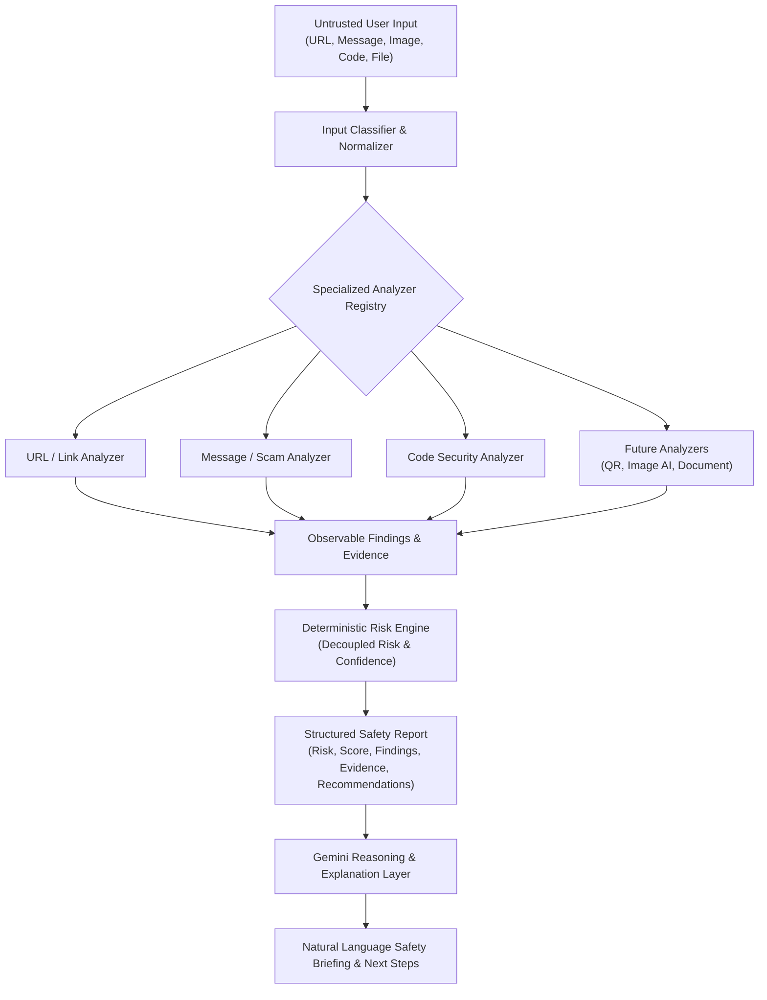

# Phase 4.6: Safety & Security Analysis Architecture

## 1. Executive Summary & New Theme

MyAI has evolved its specialized focus into a practical, AI-powered **Digital Safety & Security Assistant**:
> *"Check. Verify. Protect."*

The assistant provides accessible, rigorous analysis across multiple digital vectors—evaluating URLs, messages, emails, images, documents, QR codes, websites, code snippets, and unverified social claims.

### Core Philosophy
- **Check → Analyze → Identify Signals → Assess Risk → Explain → Recommend Action**.
- **No False Certainty**: The system never promises "100% safe", "100% scam", or "100% AI-generated". It transparently communicates observable signals, probability, confidence, and explicit limitations.
- **Deterministic Signals First, Gemini for Reasoning**: Specialized analyzers and deterministic heuristics extract factual indicators; Gemini acts strictly as the explanatory and conversational layer.



---

## 2. Input Classification & Supported Types

Inputs are normalized and classified into structured categories:
- `url`: Standalone web links, domains, or IP addresses.
- `message`: Direct messages, SMS, WhatsApp text, chat snippets.
- `email`: Raw email headers, phishing lures, forward chains.
- `image`: Screenshots, visual memes, profile pictures, photos.
- `screenshot`: Application captures, payment slips, chat screenshots.
- `document`: PDF, DOCX, presentation files, attachments.
- `file`: General binary or text attachments.
- `qr`: Decoded QR payloads or QR code imagery.
- `website`: Full web pages or online service endpoints.
- `code`: Scripts, configuration files, source code snippets.
- `claim`: Viral news, social media assertions, financial claims.
- `social_post`: Public feeds, viral captions, promotional advertisements.

---

## 3. Analyzer Architecture

Analyzers implement a standardized contract:
```typescript
export interface SafetyAnalyzer {
  readonly id: string;
  readonly type: AnalyzerType;
  readonly supportedInputTypes: readonly SafetyInputType[];
  canAnalyze(input: SafetyInput): boolean;
  analyze(input: SafetyInput): Promise<AnalyzerResult>;
}
```

### Initial Specialized Analyzers
1. **URL & Link Analyzer (`UrlAnalyzer`)**:
   - Evaluates protocol security (HTTP vs HTTPS).
   - Flags raw IP hostnames bypassing domain registration.
   - Detects URL shortening services (`bit.ly`, `tinyurl.com`, etc.) hiding destinations.
   - Detects high-risk or statistically abused TLDs.
   - Checks lookalike domain patterns and brand spoofing heuristics.
   - Detects Punycode/IDN homograph attack indicators (`xn--`).
   - Identifies plaintext credentials or session tokens in query strings.

2. **Message & Scam Analyzer (`MessageScamAnalyzer`)**:
   - Identifies high-urgency or threat coercion (account termination, arrest, legal actions).
   - Detects One-Time Password (OTP) and two-factor code solicitation.
   - Flags credential update and password verification requests.
   - Identifies unrealistic financial lures, lottery winnings, and guaranteed investments.
   - Detects impersonation of shipping couriers, tax agencies, and tech support.
   - Flags explicit instructions to maintain secrecy or bypass official channels.

3. **Code Security Analyzer (`CodeSecurityAnalyzer`)**:
   - Identifies hardcoded secrets (API keys, AWS credentials, SSH private keys, GitHub PATs).
   - Flags dangerous dynamic evaluation sinks (`eval()`, `Function()`).
   - Detects SQL injection patterns using dynamic string concatenation.
   - Identifies command injection vulnerabilities in subprocess execution.

---

## 4. Deterministic Risk & Confidence Model

Risk and confidence are decoupled:
- **Risk Level**: `critical`, `high`, `medium`, `low`, `unknown`.
- **Confidence Level**: `low`, `medium`, `high`.

### Heuristic Risk Formulation
1. **Critical Risk**: Any finding with `critical` severity (e.g., active OTP theft, exposed private key).
2. **High Risk**: One or more `high` severity findings (e.g., brand spoofing, direct credential solicitation) or multiple accumulating medium signals.
3. **Medium Risk**: At least one `medium` severity finding (e.g., URL shortener, high-risk TLD, urgency markers).
4. **Low Risk**: Only `low` or `info` signals, or clean checks across all analyzers.
5. **Unknown Risk**: Incomplete parsing, missing analyzers, or corrupt input.

---

## 5. Structured Recommendations

Recommendations provide non-alarmist, proportional guidance:
- `do_not_share_otp`: Explicit warnings never to transmit two-factor codes.
- `do_not_enter_password`: Guidance to prevent credential harvesting.
- `verify_domain`: Advice to type official URLs directly into browser bars.
- `contact_official_source`: Instructions to verify unexpected claims through published channels.
- `rotate_exposed_secret`: Steps to immediately invalidate and regenerate leaked tokens.
- `scan_file_before_opening`: Advice on sandbox or antivirus scanning.
- `proceed_with_caution`: Situational awareness for ambiguous or unknown sources.
- `no_action_needed`: Reassurance when no threat indicators are found.

---

## 6. Privacy & Security Boundaries

1. **Untrusted Input Ingestion**: All user-provided text, code, and files are treated as untrusted data. No code is ever dynamically executed or evaluated on the server.
2. **Data Minimization**: Analysis history persists structured findings, metadata, and evidence summaries rather than full raw files or message copies.
3. **Row-Level Security (RLS)**:
   - `safety_analyses`, `safety_findings`, `safety_evidence`, `safety_recommendations`.
   - Users can only `SELECT` their own records (`auth.uid() = user_id`).
   - Normal authenticated users have no direct `INSERT`, `UPDATE`, or `DELETE` permissions.
4. **No Server-Side Request Forgery (SSRF)**: The system does not make arbitrary external network requests to user-supplied URLs during analysis.

---

## 7. Retained Historical Infrastructure

The database schema and ingested data from Phase 4.5 (`kb_sources`, `kb_sections`, `kb_chunks`, 174 sections, 3,773 chunks from *الطب النبوي*) remain intact and untouched in the remote database as part of the repository foundation. No tables or data rows were dropped or mutated.
